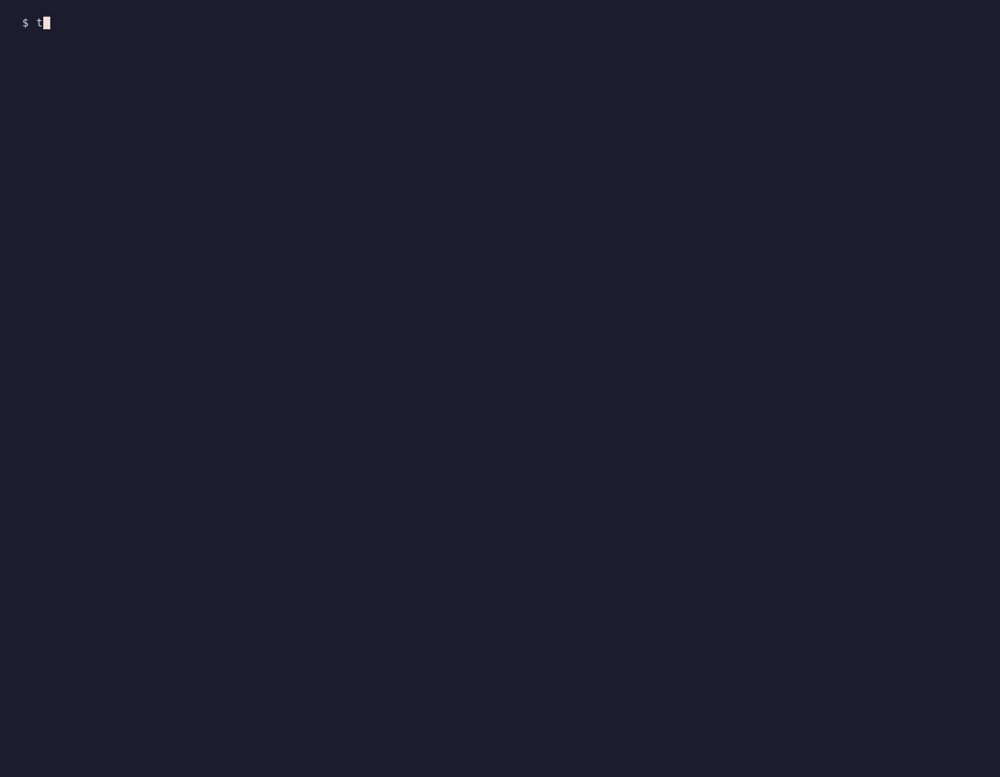
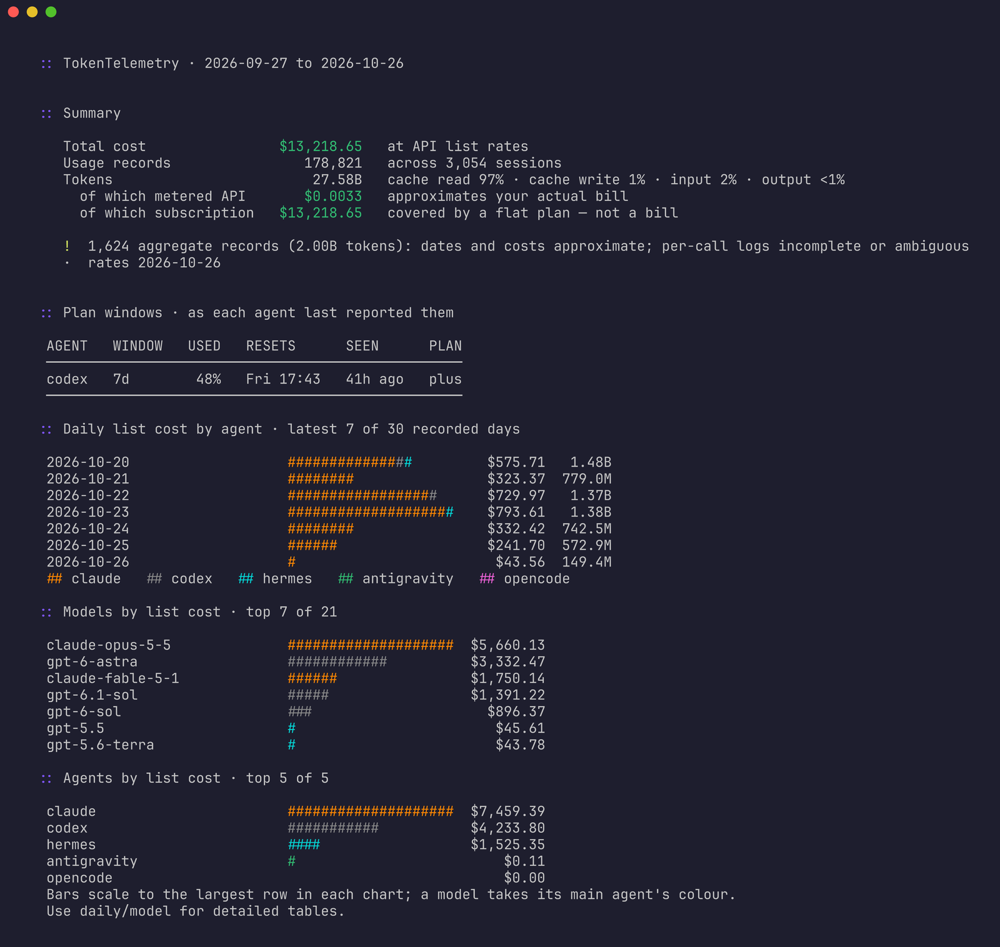
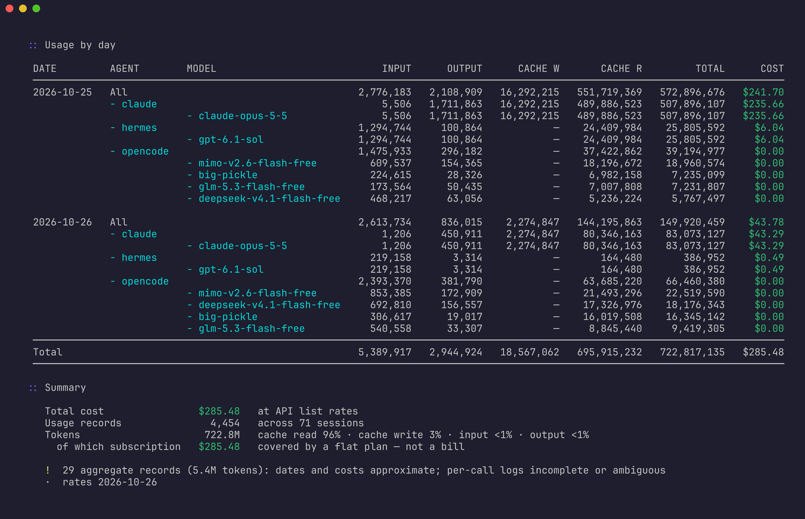
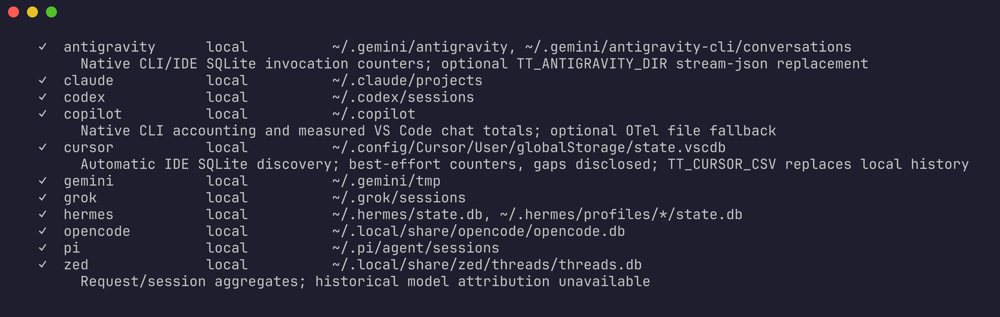

# TokenTelemetry

See what your AI coding agents use and what it would cost at API list prices,
across 40 agents, from the logs already on your machine.



<sub>Real usage from the maintainer's machine, with home paths shortened. The
dollar figures are API list value, mostly covered by subscriptions, not a bill.</sub>

## Install

Linux or macOS (swap in `darwin` and `arm64` as needed):

```sh
curl -fsSL https://github.com/semyonfox/tokentelemetry/releases/latest/download/tokentelemetry_linux_amd64.tar.gz | tar -xz
mv tokentelemetry_linux_amd64/tokentelemetry tokentelemetry_linux_amd64/tt ~/.local/bin/
```

With Go 1.26 or newer:

```sh
go install github.com/semyonfox/tokentelemetry/engine/cmd/tt@latest
```

This installs the short `tt` name only.

Windows zips, the other platforms and `checksums.txt` are on the
[releases page](https://github.com/semyonfox/tokentelemetry/releases).

## First commands

```sh
tt                               # last 30 days: totals, daily cost, top models and agents
tt daily --group-by agent,model  # every day, split by agent and model
tt agents --installed            # which agents were found, and where
tt -a --json                     # all history as JSON for your own scripts
```

`tt` and `tokentelemetry` are the same program.

## Why not ccusage?

[ccusage](https://github.com/ryoppippi/ccusage) is the established tool here and
is great if most of your usage is Claude Code. TokenTelemetry is for people who
move between agents. It reads Claude Code, Codex, Copilot CLI, Cursor, Cline,
Roo, Kilo, Qwen, Goose, Zed and 30 more into one report with one set of pricing
rules. It keeps unknown models unpriced rather than guessing, and it separates
subscription usage from metered API spend.

## How it works

```
 agent logs and SQLite       adapters           Go engine              output
 ~/.claude, ~/.codex,   ->  one reader   ->  normalise tokens,   ->  terminal charts
 Cursor, Copilot, Zed...    per agent        dedupe, price,          and tables, or
                                             aggregate by day        --json
```

Each adapter reads the files an agent already writes and turns them into the
same four token buckets: fresh input, output, cache reads and cache writes. The
engine removes duplicates, applies effective-dated list prices and builds the
report. Your usage never leaves the machine. The only network request is a
daily check for updated model prices, which `TT_OFFLINE=1` turns off.

## Screens

`tt`, the 30-day summary:



`tt daily --group-by agent,model --since 2026-10-25`:



`tt agents --installed`:



## Supported agents

The [provider inventory](docs/provider-inventory.md) lists all 43 audited adapters:
41 local readers/importers, plus explicit source limitations for Crush and
Grokbot. Coverage includes Copilot CLI and supported VS Code stores, Cursor local counters
and CSV exports, Cline, Roo, Kilo,
Qwen, Goose and Zed. Some sources provide only session totals or credits.
Run `tokentelemetry agents` to see coverage and detected source paths.

## Using the reports

Use `tt help` for the command overview and `tt help summary` or
`tt daily --help` for command-specific flags. `tt agents --installed` lists
detected sources; `tt agents cursor copilot` narrows the catalog to named agents.
`sessions`, `models`, `projects` and `providers` are aliases for the existing
singular report commands and `agents`.

The default command is `summary`, covering the last 30 local calendar days.
It shows accounting totals, daily list-cost bars stacked by agent, and models and agents ranked by
API list cost. Each chart shows up to seven rows. `--limit N` changes that
number and `--limit 0` shows every row, without changing the headline totals.
Daily bars show the latest recorded
days; missing days are not presented as verified zero usage. Each chart scales
its bars independently.

Interactive reports show a startup spinner while checking prices, scanning
logs and calculating totals. It clears before the report appears and stays off
for redirected output.

Use `--plain` to omit bars and the spinner, or `--json` for the complete report without display
limits. Bars also disappear when `COLUMNS` is set below 72. `--no-color` and
`NO_COLOR` disable colours. Reports print once and exit; there is no interactive
terminal UI to manage.

Use `--all-time` or `-a` for all available history, including undated records.
`tokentelemetry -a` runs an all-time summary without typing the command name.
Explicit date filters replace the summary's default window and cannot be combined
with `--all-time`. Detailed commands such as `daily` and `model` already include
all history unless filtered.

Repeated reports reuse a local cache of parsed usage for supported readers.
`--no-cache` forces a fresh scan; `--verbose` shows cache hits and misses.
See [cache coverage and invalidation](engine/README.md#scan-cache).

## Accounting

Each reader normalises usage into fresh input, output, cache reads and cache
writes. Reports use the same pricing and aggregation code for every command.
Rates are embedded, effective-dated and include supported context tiers and cache
rates. Unknown models and ambiguous session attribution keep their token counts
but contribute no invented cost. Measured tokens without a reliable split remain
unclassified. Kiro and Codebuff credits are reported separately from tokens and
dollars. See the inventory for import configuration and source-specific limits.

The dollar total is API list value, not a provider invoice. Subscription and
local usage are classified separately. Optional plan costs in
`~/.tokentelemetry/plans.json` are prorated over the matched activity window.
They do not establish actual invoiced spend or allocate a plan's cost to a
particular model or project. The summary also shows the five-hour and weekly
subscription windows an agent reports about itself: Codex from its session
logs, Claude Code through the `tt statusline` hook described in the
[engine README](engine/README.md#plan-windows).

Accuracy has limits:

- Codex JSONL readers prefer structured per-response usage identities. Legacy
  turns without those records retain timing-based fork replay detection, disclosed
  in the report.
- Hermes uses per-call log timestamps only when usage fully reconciles with an
  unambiguous database row. Otherwise it preserves the aggregate, labels its
  dates/cost as approximate, and uses base context rates. Auxiliary tasks,
  ambiguous routes and incomplete logs remain aggregates. Log timestamps use
  the local timezone.
- Usage older than available price history uses the earliest known rate, with
  the affected cost disclosed.
- Hermes aggregates explicitly linked to a scanned Codex runtime thread are
  excluded from combined totals and retained in JSON `excluded_overlaps`. Mixed
  sessions and older histories without shared identities cannot be fully
  reconciled. See [runtime overlap rules](docs/provider-evidence-overlap.md).
- Missing, unreadable or changed source logs can make reports incomplete.
  Compressed Codex rollouts are not currently read.
- Cursor's local counters are best-effort and often empty. Automatic discovery
  reads measured counters and reports gaps; missing cache details stay unpriced.
  An optional CSV replaces local history. See [Cursor setup](engine/README.md#cursor-usage).
- GitHub Copilot scans its already-written CLI session store and shutdown
  journal, plus VS Code's persisted chat-session records when they include
  complete per-model totals for a recognized GitHub Copilot participant. It
  never enables telemetry, and it does not retain or report prompt and response
  text. Valid request rows remain authoritative. Shutdown snapshots add only
  usage that reconciles against those rows in every token bucket; ambiguous
  differences produce warnings. Older stores without measured counters remain
  unavailable. The Copilot CLI
  Agent Host's duplicate VS Code copy is excluded. An optional Copilot CLI
  OpenTelemetry file export fills conversations without native usage; native
  records take precedence for overlapping conversations. See
  [export setup and limits](engine/README.md#optional-copilot-file-exports).
- Grok Build prefers its native `usage.json` ledger and uses legacy completion
  counters only when that ledger is absent. Missing timestamps and uncertain
  model attribution remain explicit and unpriced. Proven parent/child folds
  count once; otherwise exact child history takes precedence over ambiguous
  parent aggregates, with a warning. Its subscription billing label is a
  normal-route default, not invoice attribution.
- Antigravity reads recognized invocation metadata from schema-gated local
  conversation databases. Unsupported database versions/layouts, malformed
  records and oversized metadata blobs are skipped with no transcript-based
  token estimates; numeric-only models remain visible but unpriced unless a
  pricing alias maps them. Its metadata has no endpoint or credential-mode
  field, so its subscription billing label is likewise a normal-route default,
  not invoice attribution.
- Tests cover specific storage formats and accounting cases, not every provider
  version or billing arrangement.

See [the command reference](engine/README.md) for filters, plans and pricing.
The [documentation index](docs/README.md) links provider setup, accounting
evidence, the porting plan and contributor guidance.

## Build from source

Requires Go 1.26 or newer.

```sh
make build
./dist/tokentelemetry
./dist/tt -a
```

`make build` produces both `dist/tokentelemetry` and `dist/tt`.

## Development

```sh
make test
make check
make build
make release TAG=v0.1.0  # archives and checksums for every platform in dist/release
make packages  # optional: needs Node.js; builds six native npm packages + launcher
```

The Go module remains under `engine/`. Generated npm packages live in `engine/dist/npm`;
this checkout does not establish that they have been published. Releases are
built and published locally, see [development notes](docs/development.md#releases).

## Project origins

This project began from Hemanth Vasi's TokenTelemetry application. This version
focuses on the Go CLI and removes the inherited Python backend, Next.js dashboard,
website, plugins and deployment tooling. The Git history retains that work and
its attribution. The original MIT notice remains in [LICENSE](LICENSE).

No existing user logs, configuration, databases or running services are migrated
or removed by this source-code change. The CLI reads original agent logs; it
does not import the old dashboard's retained history database.

Models and prices update automatically when you run a report or `price`.
The CLI checks the dataset published by daily CI at most once per day, with a
three-second timeout and a cached or bundled fallback. No manual sync is needed.
Set `TT_OFFLINE=1` to skip network checks. Your pricing overrides still take priority.
Updates preserve recorded rate history; newly observed changes take effect on
the sync date. Paid-to-zero changes are retained at their previous rates for review.
